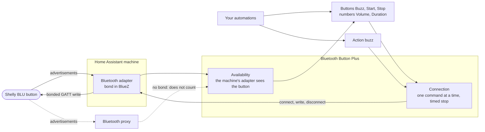
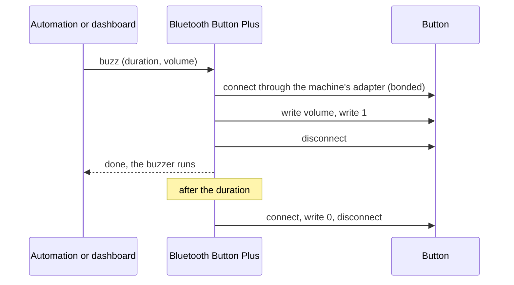
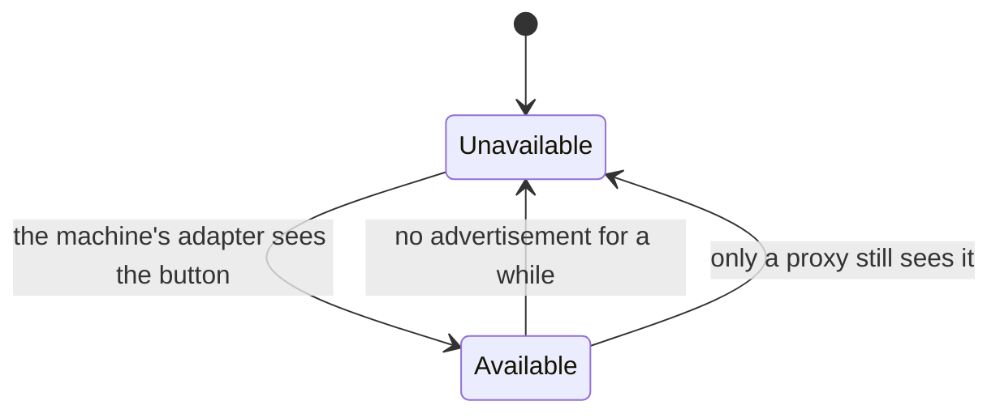

# Bluetooth Button Plus

[](#installation)

A Home Assistant integration that puts the buzzer of a Shelly BLU button into Home Assistant: the button *Buzz* that buzzes for a number of seconds, *Start buzzer* and *Stop buzzer*, the numbers *Buzzer volume* and *Buzz duration*, and the action `bluetooth_button_plus.buzz`. It complements the integrations that already read the button, [BTHome](https://www.home-assistant.io/integrations/bthome/) for the presses and the battery and, for example, [Bermuda](https://github.com/agittins/bermuda) for the room. Neither of them writes to the button; this one does nothing else. This project is not affiliated with or endorsed by Shelly.

What it is for, for example:

- find a button that is attached to something that wanders, such as a dog's harness or a key ring, with a tap on a dashboard;
- let the button on the key ring beep when the front door opens and the keys are still on the hook;
- a short, loud beep from a script, at a volume for this one buzz only.

## Design

### Overview



Shelly BLU buttons have a Bluetooth characteristic *Find my device*. Writing a 1 to it starts the buzzer, a 0 stops it, and the button stops it by itself after a minute. A second characteristic holds the volume, 0 to 3. Both are readable and writable only over a **bonded** connection, so the button has to be paired with the Bluetooth adapter of the Home Assistant machine once, see [Pairing](#pairing). The bond lives in the Bluetooth stack (BlueZ) of that machine, so only its own adapter can write to the button.

### A press



Every command connects, writes and disconnects right away: the button is a battery device and advertises only while nothing is connected. *Start buzzer* writes the volume and the 1, *Stop buzzer* the 0. *Buzz* and the action `buzz` start the buzzer the same way and stop it after the duration, in the background; the call returns once the buzzer started.

Commands for one button run one after the other, never interleaved. A new buzz or *Stop buzzer* replaces a pending timed stop only once its own write succeeded: if a second buzz cannot reach the button, the first one still stops on time. Unloading the integration (a reload or an update) drops a pending stop and waits for a command in progress; the button then stops the buzzer by itself after a minute at the latest.

### Range and availability



The buttons and the volume are available only while the adapter of the Home Assistant machine sees the button. A Bluetooth proxy does not count, not even one that can connect: Shelly devices as proxies only forward advertisements, and an [ESPHome proxy](https://esphome.io/components/bluetooth_proxy.html) holds no bond with the button, which refuses it. With several adapters on the machine, the one with the best signal is used.

Out of range, the entities are *unavailable*, and Home Assistant skips a press or the action for an unavailable entity: an automation goes on, and the log notes that the entity is unavailable. Only in the short gap between the last advertisement and the moment Home Assistant marks the button unavailable does a press fail with a message of its own.

### Settings

*Buzzer volume* and *Buzz duration* are kept in the integration's configuration, so they survive a restart and a disabled entity. The duration exists in Home Assistant only and can be set while the button is away. The volume is written to the button when set and again before every start of the buzzer. The button cannot be asked for its volume without a connection, so a volume changed in the Shelly app is not shown here; it is overwritten at the next start.

### Supported devices

| Device | Status |
|---|---|
| Shelly BLU Button Tough 1 ZB (SBBT-102C) | Tested |
| Other Shelly BLU buttons (`SBBT-*`) with a buzzer | Offered, not tested |

The buzzer characteristic is documented for the BLU Button1 and the BLU Button Tough 1 as well. During setup the integration connects once, refuses a device without the buzzer or the volume, and reads the volume, which checks the pairing. If a button works for you that is not listed as tested, please open an [issue](https://github.com/n-schilling/ha-bluetooth-button-plus/issues).

### Privacy

The integration stores the Bluetooth address and the model name of each button in its config entry, and the two settings in its options. It reads nothing from the button but the volume during setup, and sends nothing anywhere else.

## Examples

A script that makes the button buzz loudly for five seconds:

```yaml
sequence:
  - action: bluetooth_button_plus.buzz
    target:
      entity_id: button.sbbt_102c_ee01_buzz
    data:
      duration: 5
      volume: 3
```

An automation that lets the key ring beep when the front door opens while the keys are still home:

```yaml
triggers:
  - trigger: state
    entity_id: binary_sensor.front_door
    to: "on"
conditions:
  - condition: state
    entity_id: device_tracker.key_ring
    state: home
actions:
  - action: bluetooth_button_plus.buzz
    target:
      entity_id: button.sbbt_102c_ee01_buzz
    data:
      duration: 3
```

The device of the button works as target as well; it buzzes once.

## Known limitations

- Range: only the adapter of the Home Assistant machine, which holds the bond, can trigger the buzzer, and only while it sees the button. Bluetooth proxies do not extend the range.
- The bond lives in BlueZ on the machine. A new Bluetooth adapter, or a reinstalled machine, needs a new pairing.
- Home Assistant cannot pair Bluetooth devices itself; pairing takes `bluetoothctl` on the host once.
- Nothing is read from the button during operation; its presses and battery come from BTHome. The volume shown is the value Home Assistant set last, not the button's.

## Troubleshooting

- **The entities are unavailable, but the button is seen:** another integration may see it through a Bluetooth proxy. Only the adapter of the Home Assistant machine counts; bring the button closer to the machine.
- **Setup or a press says the button refused the access:** the bond is missing. A button remembers four paired devices and a fifth replaces the one used least; pair it again, see [Pairing](#pairing).
- **"Could not connect":** the button is busy with another connection (the Shelly app, for example) or at the edge of the range; try again.
- **A press succeeds, but nothing beeps:** enable *Buzzer* in the device settings of the Shelly app, and check that *Buzzer volume* is not 0.

## Interface

### Entities

| Entity | Description |
|---|---|
| Buzz (`button`, device class `identify`) | Buzzes for the *Buzz duration* at the *Buzzer volume*, then stops the buzzer in the background. |
| Start buzzer (`button`) | Writes the buzzer volume and starts the buzzer. The button stops it by itself after a minute. |
| Stop buzzer (`button`) | Stops the buzzer before that, and replaces a pending timed stop. |
| Buzz duration (`number`, configuration) | Seconds *Buzz* and the action without `duration` buzz, 1–60 (default 10). Always available. |
| Buzzer volume (`number`, configuration) | 0 off, 1 low, 2 medium, 3 high (default 1). Written to the button when set and before every start. |

Unique IDs are `<address>_<key>` with the keys `buzz`, `buzzer_on`, `buzzer_off`, `duration` and `volume`.

### Action `bluetooth_button_plus.buzz`

Starts the buzzer and stops it after a time. The action exists as soon as the integration is set up, also while no button is loaded.

| Field | Default | Description |
|---|---|---|
| `duration` | the buzz duration | Seconds until the buzzer is stopped, 1–60, for this one buzz only. |
| `volume` | the buzzer volume | 0–3 for this one buzz only. |

Target: the *Buzz* button, or its device. *Start buzzer* and *Stop buzzer* are no targets.

## Installation

1. **Settings → Marketplace → Add from link** (top right), enter `https://github.com/n-schilling/ha-bluetooth-button-plus` as GitHub link and add it. Adding a repository by link asks you to connect GitHub once.
2. Install **Bluetooth Button Plus** in the Marketplace and restart Home Assistant.
3. Pair the button with the Bluetooth adapter of the Home Assistant machine, see [Pairing](#pairing).
4. A paired button in range is discovered and shown under **Settings → Devices & services**; confirm it. Or add one by hand: **Add integration → Bluetooth Button Plus** and pick the button from the buttons the machine's adapter currently sees.

During setup the integration connects once to the button and reads its volume. A button that is not paired refuses that, and the setup says so.

Requires Home Assistant 2026.11 or later and a Bluetooth adapter on the Home Assistant machine. Without the Marketplace, copy `custom_components/bluetooth_button_plus` into the `custom_components` folder of your configuration directory and restart. There are no requirements outside Home Assistant.

### Pairing

On a Linux host (Home Assistant OS, Supervised, Container) pair once with `bluetoothctl`; the bond is stored by BlueZ and survives restarts. On Home Assistant OS, `bluetoothctl` runs on the host, reachable through the [SSH access to the host](https://developers.home-assistant.io/docs/operating-system/debugging/) on port 22222.

Pairing with a passkey protects it against someone who listens in or steps in during that minute. Pairing without one ("Just Works") has no such protection; then pair where nobody else is around. Both give the integration the same access.

1. **With a passkey:** turn on *Security* in the device settings of the Shelly app and note the six-digit passkey. This also encrypts the button's BTHome advertisements; BTHome then needs the button's encryption key. **Without a passkey:** leave *Security* off.
2. Put the button into pairing mode: four quick presses, or hold it for ten seconds, until it plays a short tone. Pairing mode lasts one minute.
3. On the host, within that minute, with a passkey:

    ```
    bluetoothctl
    agent off
    agent KeyboardOnly
    default-agent
    pair AA:BB:CC:DD:EE:FF
    ```

    `bluetoothctl` asks for the passkey. Without a passkey, use `agent NoInputNoOutput` instead of `agent KeyboardOnly`; no code is asked for.

    `Pairing successful` is the answer you want. If the first attempt answers `ConnectionAttemptFailed`, the button was not in pairing mode yet; try again.
4. `info AA:BB:CC:DD:EE:FF` shows `Paired: yes` and `Bonded: yes`.

A Shelly BLU button remembers four paired devices; a fifth replaces the one used least. The Shelly app on your phone is one of them. Remove bonds you no longer need, in the Shelly app or with `bluetoothctl remove AA:BB:CC:DD:EE:FF` on a machine that should no longer reach the button.

The buzzer has to be enabled in the Shelly app (*Buzzer* in the device settings), and *Beacon mode* keeps the button advertising often enough to be found.

### Removal

**Settings → Devices & services → Bluetooth Button Plus → ⋮ → Delete** for each button removes its device and entities. Then remove the integration in the Marketplace and restart. The bond stays in BlueZ until you remove it with `bluetoothctl remove`.

## Development

```bash
uv venv --python 3.14 && uv pip install -r requirements_test.txt
scripts/check.sh
```

`scripts/check.sh` runs what CI runs: ruff, the changelog and translation checks, mypy, the tests with their coverage threshold and hassfest in Docker. The CI job HACS, which validates the repository for the Marketplace, runs on GitHub only.

The tests simulate the machine's adapter and the button; no Bluetooth hardware is needed.

Releases: CI on `main` tags the version from `manifest.json` and publishes a GitHub release with its CHANGELOG section; the Marketplace offers it as an update.

## License

Apache License 2.0, see [LICENSE](LICENSE).
